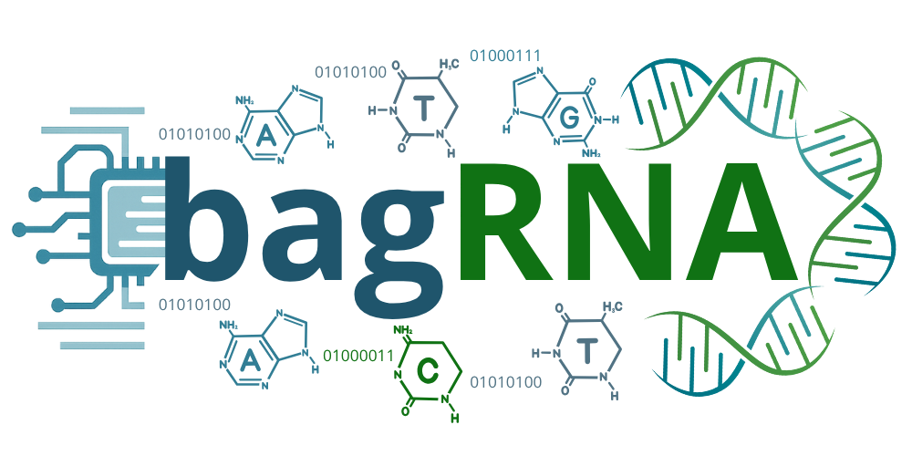
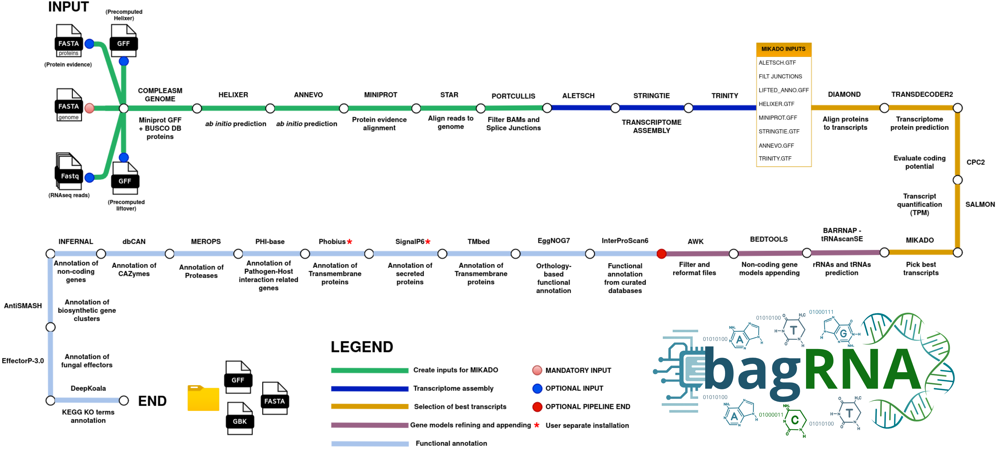

A Nextflow DSL2 pipeline for end-to-end eukaryotic genome annotation. It integrates RNA-seq evidence, ab initio gene predictors, structural annotation, and functional annotation into a single reproducible workflow, with all steps running in Docker containers.



Full documentation: https://gabrielerigano99.github.io/bagRNA/

## Start here: your first annotation, step by step

Follow the steps in order. Every command is copy-paste. Lines starting with `#` are comments, not commands.

**What you will get:** a gene annotation (GFF3), the predicted proteins, an NCBI-ready submission file, and an HTML/PDF report with functional annotation.

### How it fits together

```
  YOUR FILES                                   bagRNA                              YOU GET
 ┌─────────────────────────┐   ┌───────────────────────────────────────┐   ┌──────────────────────────┐
 │ genome.fa   (required)  │   │ 1. Structural annotation              │   │ gene models (GFF3)       │
 │ proteins.faa (required) │──►│    find genes: ab initio + RNA-seq    │──►│ protein sequences        │
 │ RNA-seq reads (optional)│   │    + protein evidence -> Mikado       │   │ NCBI submission files    │
 │ NCBI .sbt template      │   │ 2. Functional annotation              │   │ annotation report        │
 └─────────────────────────┘   │    what do the genes do?              │   │ (HTML + PDF + table)     │
        Databases (step 3) ───►│    InterPro, eggNOG, KEGG, ...        │   └──────────────────────────┘
                               └───────────────────────────────────────┘
```

### Step 0. Check your computer (2 minutes)

| You need | Notes |
|---|---|
| Linux (Ubuntu/Debian is easiest) | macOS and Windows are not tested |
| Docker | every tool runs inside Docker, so you install nothing else per tool |
| Java 21 and Nextflow 25.04.6 | Nextflow runs the pipeline |
| Disk space | the databases alone are large (eggNOG about 46 GB, InterProScan about 50 GB), plus space for each run |
| RAM | eggNOG needs about 35 GB in memory. Use a machine with 64 GB or more for the full pipeline |
| NVIDIA GPU | optional. Add `--use_gpu` to speed up some steps. Needs the [NVIDIA Container Toolkit](https://docs.nvidia.com/datacenter/cloud-native/container-toolkit/latest/install-guide.html) |

### Step 1. Install the tools (10 minutes)

```bash
# Java 21 (Ubuntu/Debian)
sudo apt install openjdk-21-jre-headless

# Docker, then let your user run it (log out and back in afterwards)
curl -fsSL https://get.docker.com | sh
sudo usermod -aG docker $USER

# Nextflow
curl -s https://get.nextflow.io | bash
sudo mv nextflow /usr/local/bin/
```

Tell your shell which versions to use. Run these two lines **every time you open a new terminal** (or add them to `~/.bashrc`):

```bash
export NXF_VER=25.04.6
export JAVA_HOME=/usr/lib/jvm/java-21-openjdk-amd64   # adjust if your Java 21 lives elsewhere
```

Check that it works:

```bash
docker run --rm hello-world     # prints "Hello from Docker!"
nextflow -version               # prints version 25.04.6
```

### Step 2. Download bagRNA (1 minute)

```bash
git clone https://github.com/GabrieleRigano99/bagRNA.git
cd bagRNA
```

### Step 3. Download the databases (one time, takes a long time)

Pick a folder with plenty of free space and run:

```bash
nextflow run main.nf -entry SETUP --db_dir /path/to/databases
```

You only do this once. Skip it if you only want structural annotation (genes without functions).

### Step 4. Get your input files

| File | Option | What it is |
|---|---|---|
| Genome | `--genome_fasta` | Your assembly in FASTA format. Soft-masked repeats are recommended |
| Protein evidence | `--prot_evidence` | Proteins from related species, e.g. the reviewed UniProt proteins of your taxon, as a FASTA file |
| Species name | `--species` | With an underscore, e.g. `Fusarium_oxysporum` |
| BUSCO lineage | `--busco_lineage` | Name of the closest BUSCO lineage, e.g. `sordariomycetes` or `fungi_odb10` |
| NCBI template | `--submission_template` | The `.sbt` file you create on the NCBI submission portal |
| RNA-seq (optional) | `--star_manifest` | A tab-separated text file, one line per sample: `R1.fastq.gz`, then `R2.fastq.gz`, then a condition name. Without it, genes are predicted without RNA-seq evidence |

### Step 5. Choose how to run it

**Option A: the browser GUI (easiest).** You fill in a form and press Run.

```bash
cd gui
./start_bagrna.sh
```

Open http://localhost:8765 if it does not open by itself. Choose a mode, fill the form, and watch the progress. Details: [`gui/README.md`](gui/README.md).

**Option B: the command line.** Pick the mode that fits:

```
 Do you already have gene models / proteins?
   |
   +-- no  --> want functions too? --+-- yes --> MODE 1: Full
   |                                 +-- no  --> MODE 2: Structural only
   |
   +-- yes --> MODE 3: Functional only
```

*Mode 1: Full (genes and functions)*

```bash
nextflow run main.nf \
    --genome_fasta genome.fa \
    --prot_evidence proteins.faa \
    --busco_lineage sordariomycetes \
    --star_manifest star_manifest.tsv \
    --species "Genus_species" \
    --submission_template template.sbt \
    --helixer_lineage fungi \
    --databases /path/to/databases \
    --outdir results \
    --use_gpu
```

*Mode 2: Structural only.* Same command, with `--no_functional_anno` added. You can drop `--databases`.

*Mode 3: Functional only.* Annotate a protein set you already have:

```bash
nextflow run main.nf \
    --functional_anno_only \
    --genome_fasta genome.fa \
    --protein_fasta proteins.faa \
    --species "Genus_species" \
    --submission_template template.sbt \
    --databases /path/to/databases \
    --outdir results
```

Notes:
- **Helixer** (a gene predictor) is meant for a GPU. No GPU? Replace `--helixer_lineage fungi` with `--no_helixer`, or give a ready-made result with `--helixer_gff helixer.gff`.
- **No RNA-seq?** Leave out `--star_manifest`. bagRNA then predicts genes without RNA-seq evidence.
- **No GPU?** Leave out `--use_gpu`.
- A full list of options: `nextflow run main.nf --help` or the [documentation](https://gabrielerigano99.github.io/bagRNA/).

### Step 6. Test first with a dry run (about 1 minute)

Add `-stub-run` to your command. It pretends to run each step, so you find typos and missing files without waiting hours. Container images may still download the first time.

```bash
nextflow run main.nf  <your options>  -stub-run
```

When the dry run ends with no error, run the same command again without `-stub-run`.

### Step 7. Run it for real

Use your command with `-resume` on the end. If the run stops (power cut, closed terminal, one failed step), run the same command again and it continues where it stopped instead of starting over.

```bash
nextflow run main.nf  <your options>  -resume
```

For long runs, use `screen` or `tmux`, so closing your terminal does not stop the run.

> **Never edit files in `workflows/`, `modules/` or `subworkflows/` between a run and its `-resume`.** Nextflow then recomputes almost everything. Put changes in `nextflow.config` instead.

### Step 8. Find your results

Everything is in the folder you gave with `--outdir` (for example `results/`):

| Folder | What is inside |
|---|---|
| `structural_annotation/` | **`final_struct_<species>.gff`** (your final gene models, GFF3) and **`final_proteins.faa`** (the predicted proteins) |
| `annotation_report/` | **`<species>_annotation_report.html`** and **`.pdf`** (open the HTML in a browser), plus `_annotation_summary.tbl` |
| `functional_annotation/` | the tables behind the report: eggNOG, InterProScan, KEGG, dbCAN, antiSMASH and others |
| `ncbi_submission/` and `table2asn/` | files for submitting the annotation to NCBI |

The other folders (`mikado/`, `star_align/`, ...) are intermediate results you can ignore at first.

The GUI can show a summary of any finished folder: press **Load results** and choose the folder.

### When something goes wrong

| What you see | What to do |
|---|---|
| `permission denied` from Docker | You did not log out and in after `usermod -aG docker`. Do that |
| `Nextflow version ... required` or Java errors | Run the two `export` lines from Step 1 in this terminal |
| `Parameter '--xxx' is required` | Add that option. `nextflow run main.nf --help` lists them |
| A step failed | The error names a folder under `work/`. Open the file `.command.err` in it. The GUI shows this in its failure panel |
| Out of memory or disk | Free space, then run the same command with `-resume` |
| Old results are recomputed | A `.nf` file changed, or you started from a different folder. Keep one `--outdir` and one work directory |

Still stuck? Open an issue: https://github.com/GabrieleRigano99/bagRNA/issues

---

## Reference

### What it does

**Structural annotation** (`workflows/structural_annotation.nf`, ~25 steps):

1. Genome QC — BUSCO/compleasm genome mode
2. Ab initio predictions — Helixer (GPU, optional) and ANNEVO (GPU)
3. Protein-to-genome alignment — Miniprot
4. RNA-seq alignment — STAR (all samples in one run via a manifest, RG-tagged)
5. Splice-junction filtering — Portcullis
6. Transcript assembly — Aletsch, StringTie (± long reads), genome-guided Trinity
7. Evidence integration — Mikado prepare, DIAMOND, TransDecoder2, CPC2, Salmon
8. Gene model selection — Mikado serialise/pick (fungal-tuned scoring in `assets/fungi.yaml`)
9. Post-processing — coding-model filtering, renaming, rRNA/tRNA detection, merging
10. Final cleanup — AGAT filtering, GFF cleanup, table2asn, protein/ncRNA extraction

**Functional annotation** (`workflows/functional_annotation.nf`): InterProScan6, eggNOG-mapper, KEGG Orthology (DeepKOALA), Rfam, SignalP, dbCAN, MEROPS, PHI-base, antiSMASH, and a self-contained HTML/PDF annotation report.

### Configuration notes

- **GPU steps** (`--use_gpu`) require the NVIDIA Container Toolkit; Helixer, ANNEVO, and TransDecoder2 use it when requested, DeepKOALA uses it opportunistically only if `--use_gpu` is set elsewhere in the run.
- **Docker volume mounts:** `RUN_DBCAN`, `EGGNOG` and `TRANSDECODER2_PFAM_SCAN` bind-mount their database directories (taken from `--dbcan_db`, `--eggnog_data_dir`, and `--pfam_db` / `--IPS6_databases_path` / `--databases`) so Docker can follow the symlinks Nextflow stages inputs as. If symlinks into another location still dangle inside a container, add that path with `--extra_docker_mounts /path/a,/path/b`.
- **Resource sizing:** `process_high`/`process_gpu`/`process_long` labels default to (physical RAM − 4 GB); override with `--max_memory` if your Docker daemon has a lower memory limit than the host.
- **Execution profiles:** `-profile standard` (default, local executor), `-profile slurm`, `-profile sge` for cluster execution.

### Repository layout

```
main.nf                    Entry point: validation, channel construction, workflow dispatch
nextflow.config             Params, process resource labels, Docker settings, execution profiles
nextflow_schema.json        Machine-readable parameter schema
workflows/
  structural_annotation.nf  Genome + RNA-seq -> gene models
  functional_annotation.nf  Gene models -> functional annotation
  download_databases.nf     -entry SETUP: downloads all reference databases
modules/                    One Nextflow process per file
subworkflows/interproscan6/ InterProScan6 sub-pipeline (per-member-database containers)
assets/                     Mikado scoring YAML, static reference tables, sentinel file
bin/                        Helper scripts (Python/Perl/Groovy) invoked from process scripts
lib/                        Groovy/Java dependencies used by the InterProScan6 subworkflow
docker/                     Dockerfiles for custom images (eggNOG-mapper, TransDecoder2, DeepKOALA, report generator)
gui/                        Local browser GUI (stdlib Python): fill parameters, run/stop, live progress, load results
```

## License

MIT — see [LICENSE](LICENSE).
